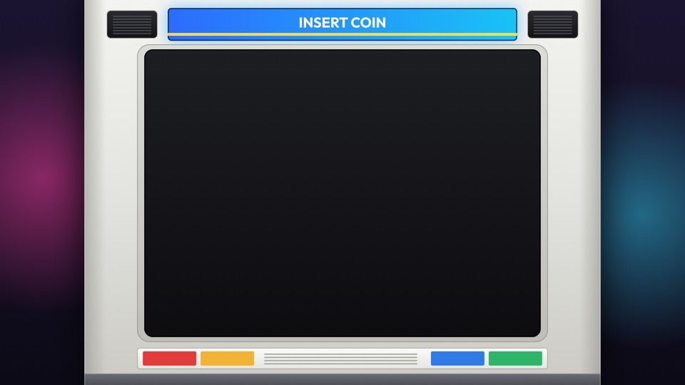
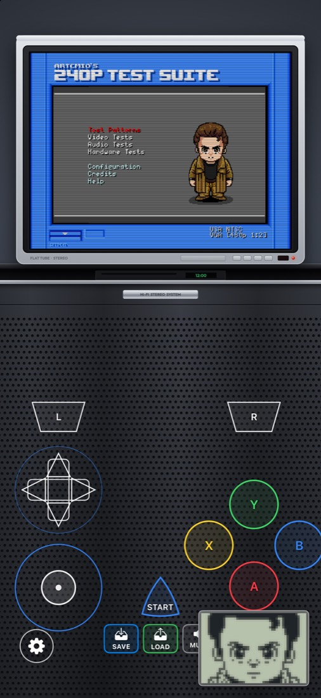
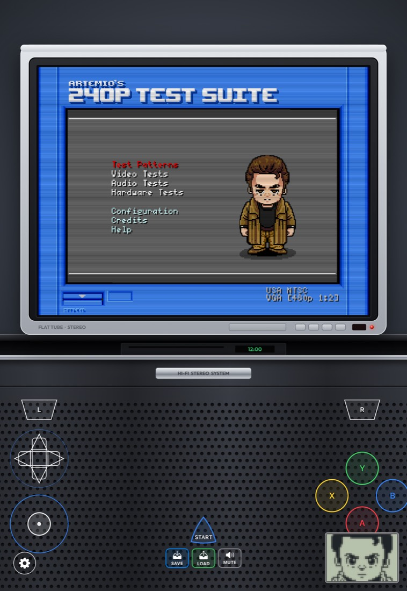

# TV bezels (`SkinKitBezels`, `SkinKitBezelsUI`)

A TV or monitor drawn around the game picture, and a strip in the pause menu that previews each TV over
the paused game. Shared by Provenance, iFly and iCube. Design: Provenance
`docs/superpowers/specs/2026-11-19-shared-bezel-module-design.md` and `2026-11-19-bezels-on-by-default-design.md`.

## What an app does

1. **Once at launch**, before anything else here is used:

   ```swift
   BezelEnvironment.current = BezelEnvironment(
       libraryRootURL: documents.appendingPathComponent("Bezels"),
       userAgent: "MyApp",
       settings: UserDefaultsBezelSettings(prefix: "myapp.bezel."),   // or the app's own BezelSettingsStore
       systems: { [.init(id: "com.provenance.dreamcast", name: "Dreamcast")] })
   BezelLog.handler = { level, message in /* the app's log */ }
   ```

   System ids are `SystemIdentifier` raw values (`com.provenance.…`): bundled TVs and The Bezel Project's
   table are keyed by them.

2. **Which TV**, whenever the game, the settings or the preview change (main actor):

   ```swift
   let resolved = BezelChoice.resolve(gameID: gameKey, systemID: systemID, systemSuitsTV: true, preview: preview)
   ```

   `gameKey` is whatever the app keys per-game settings by. `systemSuitsTV` is `false` for a system with a
   screen of its own (a handheld), which then gets no TV under Automatic.

3. **Whether it may show**: `GameplayBezelPlacement.showsTV(.init(isAppleTV:isLandscape:controls:layoutSupportsTV:choiceIsAutomatic:))`
   with `choiceIsAutomatic: resolved.resolution.isAutomatic`. Apple TV always; elsewhere in landscape with a
   controller or generated touch controls, never around a skin. In portrait, an app that shows the TV the
   plain way with a seat passes `supportsPortrait: true` and gets the same answer as in landscape; without
   it only a TV the player chose shows, and only with a controller connected. The shader way has no
   portrait scene, so an app that draws TVs through the shader leaves it off.

4. **Show it**. Two ways.
   - *Plain* (no shader, works with any presenter): `TVBezelLayout(bezel:container:pictureAspect:)` gives the
     artwork's frame and the picture's. Put `TVBezelArtworkView(bezel:)` behind the game surface for
     `.behindPicture` (a built-in TV) and above it for `.abovePicture` (an image bezel), and give the surface
     `pictureFrame`. `TVBezelStage` does all of that for a SwiftUI surface. With a `seat`, a built-in TV's
     room is drawn for the container's shape; pass the layout's `canvas` and `shape` on to
     `TVBezelArtworkView`. Two forms come from that, for a TV whose document has them:
     - *Portrait* (`TVBezel.drawsPortrait`, `"portrait": true` in the catalogue): on a portrait container
       (`TVBezelCanvas.portraitRatioRange`) the room is the whole screen, the TV at the top and a console
       running down under the touch controls. An image bezel keeps its own shape, placed near the
       top.
     - *Widescreen*: for a picture of 16:10 or wider (`TVBezelPictureShape`) the tube and cabinet are 16:9,
       so the picture has no bars. A TV without the form keeps its 4:3 tube and the picture is fitted in it, and so does any
       TV on a canvas narrower than its wide tube (a 4:3 display from the Middle or Front seat).
       `pictureAspect` is all the app passes. Pass the shape the game is set to, not each frame's: a game
       that changes shape for a menu should not change the TV.
   - *Shader* (glass, reflections, room light): `TVBezelScene.make` off the main thread, kept in
     `TVBezelSceneCache.shared`. Draw the game into a texture the size of the tube, then run the scene's
     preset over the 16:9 scene with `values` as parameters and `borderPNG` as the `BORDER` texture. The app
     needs the `bezel/uborder` presets in its slang library and must set `BezelEnvironment.hasShaderPreset`.
     Image bezels are always plain.

5. **The switcher**: make the emulator screen (or an adapter) a `BezelSwitcherSession` and show
   `BezelSwitcherHost(session:commands:showsControllerHints:onClose:onMore:)` over the paused game, where
   the game stays visible. `onMore` opens `TVBezelPickerView`. Setting `bezelPreview` must redraw the game
   through step 2.

6. **Game artwork** (optional): `await BezelChoice.fetchGameArtwork(for:)`, then resolve again when it
   returns `true`.

## The bundled TVs

`Resources/TVBezels/catalog.json` lists them in the order the picker shows them. Under Automatic a system
gets the TV whose `preferredSystems` lists it, else `living-room-tv`.

| id | Looks like | Automatic for |
|---|---|---|
| `studio-monitor` | A dark broadcast monitor on a shelf | |
| `living-room-tv` | A wood-grain console set of the 1970s and 80s | every other TV system |
| `computer-monitor` | A beige home-computer monitor | C64, Atari ST, MSX, DOS and the other computers |
| `flat-tube-tv` | A silver flat-glass set of about 2000 on an AV stand | Dreamcast, PlayStation 2, GameCube |
| `dorm-tv` | A small black TV with a tape slot and front jacks | |
| `vga-monitor` | A pale grey 19-inch flat-tube PC monitor (a Dreamcast on a VGA box) | |
| `candy-cabinet` | The front of a white sit-down arcade cabinet | Naomi, Naomi 2, Atomiswave |

 
 




Every bundled TV has the portrait and widescreen forms. They are `when` entries and `console-*` nodes
in its document, written by `python3 scripts/tv_bezel_forms.py` from the table at the top of that
script (the TV's cabinet node, the surface it stands on, and the colour and texture of what is under
it in portrait). Run it again after changing a TV's artwork, and add a row for a new TV. In a document
the forms are conditions on `"orientation": "portrait"` and on the flag `tv.wide`.

To add one: write `<id>.skin.json` (a format 2 document on the 1920x1080 canvas, drawn from shapes, with
exactly one `screen` node that is 4:3 and centred both ways), add its catalogue entry, and run
`xcrun swift test --filter SkinKitBezelsTests`. No brand names, logos or photographs: the artwork is
drawn, and a TV is named for what it is. `frame` holds the shader path's cabinet colour and glass values
(the tube's place and shape come from the artwork, never from `frame`); `look` is the filter the TV
suggests and may be left out. A system may be listed by one TV only.

## Rules that bite

- **A GPU hang is fatal for the session.** After two GPU restarts iOS refuses every frame the app submits
  until it is relaunched. With the shader path: draw the plain picture while a TV loads, watch each TV
  frame's command buffer, and on `TVFrameFailure.action(for:) == .dropTV` stop drawing the TV for the rest
  of the game. Room light is off by default before Apple GPU family 7 (`TVBezelRoomLight`).
- **No Bezel Project artwork in any repository**, bundle or test fixture. It is downloaded from the
  project's pages when the player asks.
- A `nil` `BezelPreview?` is "no preview"; a preview whose choice is `""` is Off. Do not fold them.
- **A TV the player picks is the TV shown.** The systems a built-in TV lists only feed Automatic. With a TV
  chosen, only a bezel the player added for the game's system replaces it, and only while
  `matchesSystem` is on. (Built-in TVs used to replace it too; with consoles and arcade boards listed,
  that swapped a chosen TV on most games and left the switcher's preview unchanged.)
- Stored ids never change: `living-room-tv`, `slang:bezel/…`, `file:<path inside Bezels>`, `auto`, `""`.
