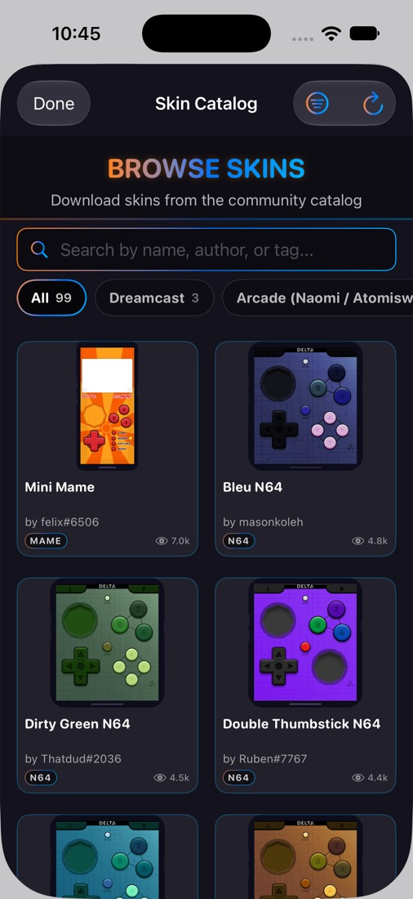
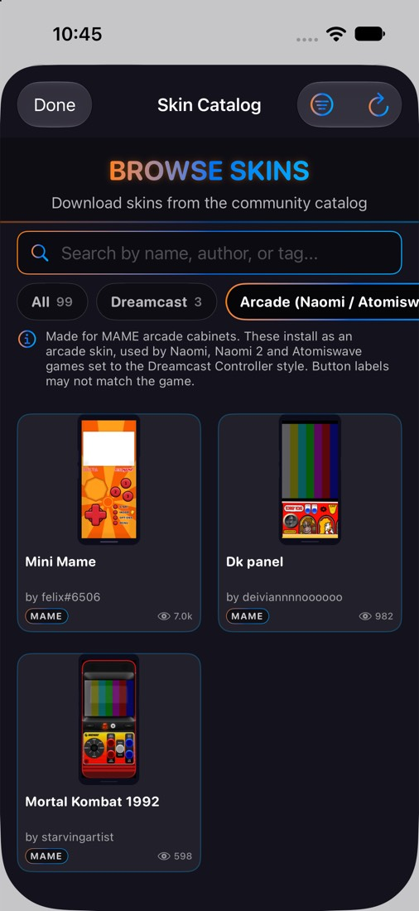
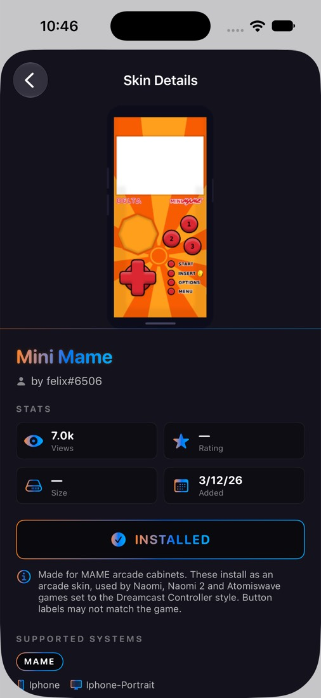
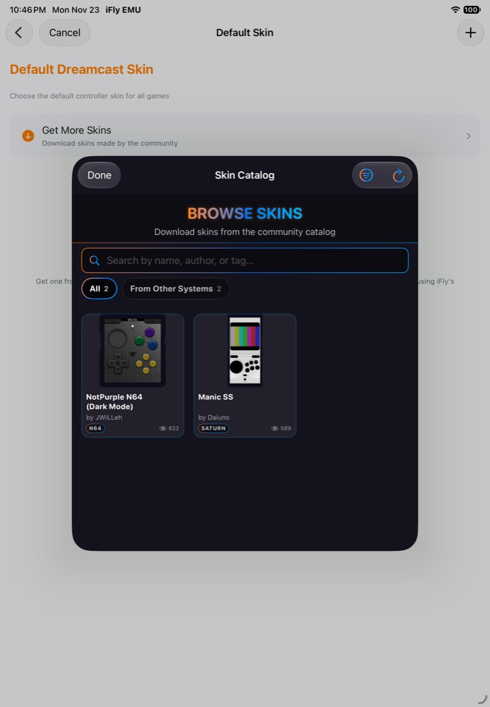
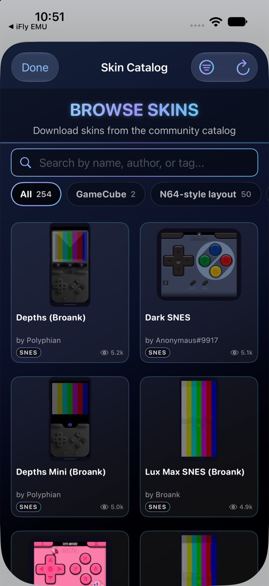
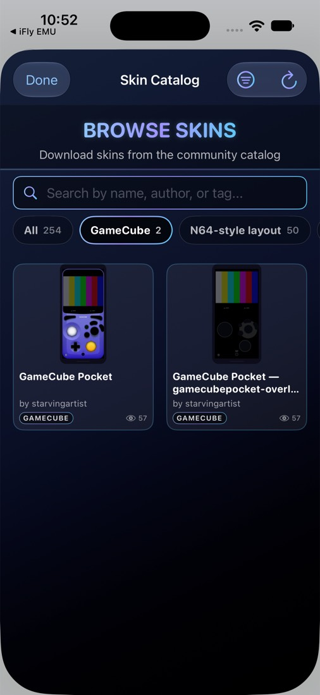
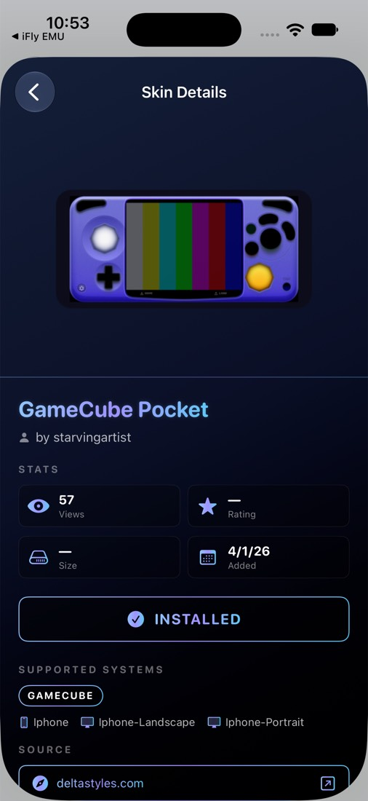
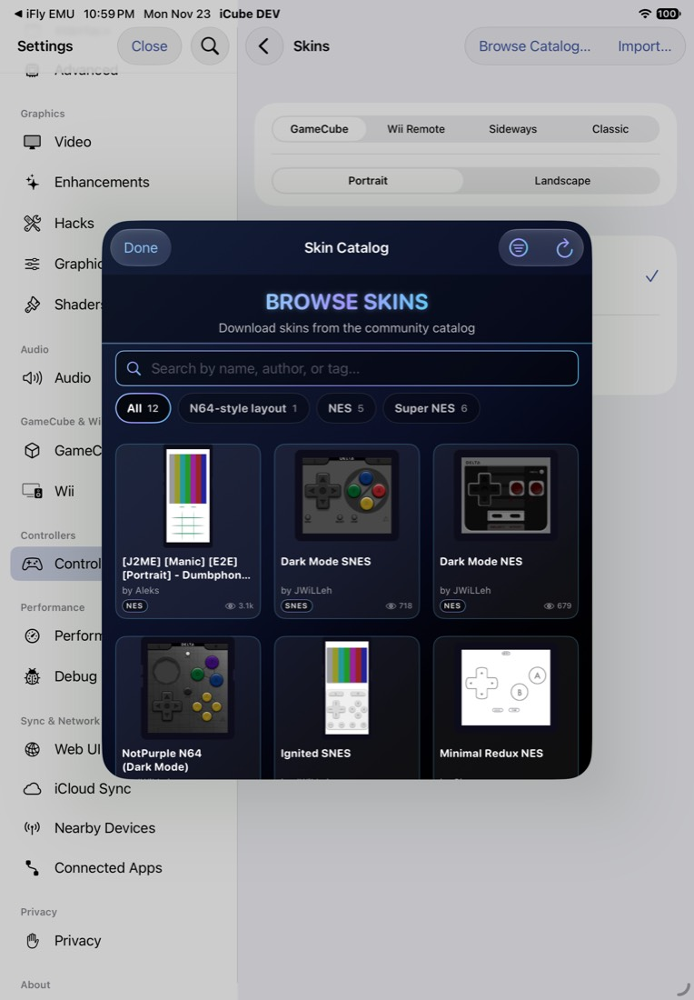

# The catalog browser as an app's store

`SkinCatalogBrowserView` (SkinKitUI) is one screen with two uses.

- `SkinCatalogBrowserView()` is Provenance's browser: the whole catalog, filtered by system, installed into
  `DeltaSkinManager.shared`.
- `SkinCatalogBrowserView(store:)` is one app's store. iFly and iCube use it, so all three apps show the same
  download screen.

## What a store host provides

A `SkinCatalogStoreHost`:

| Field | What it does |
| --- | --- |
| `policy` | The app's `SkinStorePolicy`. Its shelves are the category chips; only entries it places on a shelf and can install are listed. |
| `installer` | The app's `SkinStoreInstaller`. Installs, progress, failures and installed marks all come from it, so the app's install step, retargeting and installed record apply. `DeltaSkinManager.shared` is not read or written. |
| `device` | Hides skins made for the other device class. Starts as the device the app runs on. |
| `categoryTitle`, `categoryNote` | The app's (localized) chip titles, and a line about what installing from a shelf does. |
| `describeError` | The app's wording for a failed catalog download. |

`SkinStoreListing` (SkinCatalogKit) holds the scoping, the categories and the search as pure logic.

A store paints a cached catalog first and shows a banner when a download fails but a cached copy exists.

Not shown in a store, because they read Provenance's skin library: the device and orientation filters, "Set as
active skin", Send to RetroArch, creator profiles and the follow shelf. tvOS has no store mode yet:
`TVOSSkinCatalogBrowserView` installs into `DeltaSkinManager`.

## Strings and colours

The catalog screens look their strings up through `SkinKitLocalization` (default: the main bundle's `Localizable`
table). iCube points it at its `Core` table. Keys are the English strings.

Colours come from `SkinKitTheme.current`. The screens draw white text on the theme's backdrop, so a host keeps the
backdrop dark and sets `pink`, `purple` and `blue` to its own accents.

## How it looks

| iFly, iPhone | iFly, a shelf selected | iFly, a skin's page | iFly, iPad |
| --- | --- | --- | --- |
|  |  |  |  |

| iCube, iPhone | iCube, a shelf selected | iCube, a skin's page | iCube, iPad |
| --- | --- | --- | --- |
|  |  |  |  |
