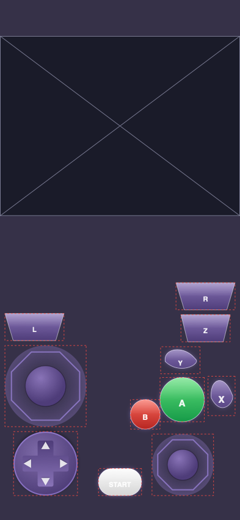
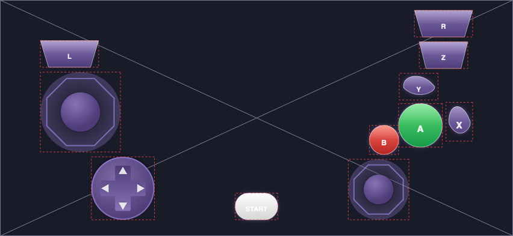

# Skin format 2.0: notes (not a design yet)

From the brainstorm on 2026-10-23. Stage 4, tentative, after the app store releases. This becomes a design document after the spike.

## Why

iCube, iFly and Provenance each generate their default skins in code (iCube first, then iFly and Provenance; Provenance added data structures for per-system designs and variants). As a file format, those skins could be shared, edited on the web, recolored, and published to emuskins.com like any other skin.

## Direction agreed so far

- **A custom declarative format**, not SVG alone and not scripts. A skin is a tree of nodes: groups, shapes, images/textures, text, controls (shapes with inputs), and screens. It's stored as JSON, with YAML maybe as a friendlier format for writing skins by hand. No embedded JS engine, because downloaded code is a security and App Review risk and can't be edited safely by tools. Simple value expressions (`"parent.width * 0.4"`) may come later.
- **Shapes:**
  - Built-in parametric shapes: rect with corner radius, squircle, ellipse, capsule, polygon(sides, rotation), star(points, innerRatio), arc, line.
  - SVG-style path strings for arbitrary curves.
  - Reusable parts with parameters, placed many times with overrides.
  - `repeat` (count, offset, rotate, scale) for stamping, e.g. grilles or keypads.
- **Paint:** stacked fills and strokes (solid, linear, radial and angular gradients, tiled image/texture fills; stroke width, dash, cap, join).
- **Effects:**
  - Portable: shadows, blur, blend modes.
  - Core Image filters as a name-plus-settings list.
  - Named materials (gloss, reflection, brushed metal, plastic grain, CRT), each implemented natively per platform.
  - Raw shader code: later, if ever.
- **Layout:** anchors (struts) to parent or named areas (`screen`, `safeArea`, `controls`) with offsets and fixed, fractional or aspect sizes, min/max. Stacks and grids with flexible spacing act as the springs. One skin adapts to every device and orientation. Default positions are hints; player edits are saved as offsets.
- **Tokens and variants:** named colors and sizes (`$accent`). A theme is a set of token values, and a game variant overrides some nodes. This replaces `themes`/`gameOverrides` for 2.0 skins.

## Non-negotiables

- **Bake to classic.** Every 2.0 skin can be rendered to a classic Delta/Manic skin: a PDF per device/orientation plus classic `info.json` items and screens.
- **Two renderers, one result.** Swift (`SkinKitUI`, Core Graphics/SwiftUI `Canvas`) and TypeScript (website previews and editor), checked against shared reference images.

## Open questions for the design

- How node coordinates are expressed: points in a reference size, or fractions?
- How controls' hit areas derive from shapes (bounds plus extended edges?).
- Versioning and feature detection (`formatVersion`, required features).
- Where the files live inside a skin (`skin.json` next to `info.json`? inside it?).

## Spike findings (2026-11-03)

Spike for #24: iCube's generated GameCube pad (`TouchOverlayDefaults.gameCube`, `TouchOverlayArt`) written as one draft-2.0 JSON file and rendered by a throwaway `SkinKit2Spike` module on branch `spike/format-2` (not merged). One skin produced both orientations from the layout rules; the renderer is one Core Graphics drawer used by a PNG test and by a SwiftUI `Canvas` through `withCGContext`.

 

iPhone 393×852 with its safe area, 1× with hit frames dashed. Landscape is the same file: the d-pad and C-stick carry a `when: orientation=landscape` offset (iCube's 70 pt diagonal), the screen switches from "top of the safe area, 4:3, full width" to "fill".

**What mapped cleanly**

- iCube's palette became 18 tokens; its Wii variant is a 4-token theme. A/B/Start colours are part arguments.
- Two parts (`faceButton`, `stick`) with parameters cover 9 of the 11 controls. `faceButton` takes its shape as an argument, so A, B, X, Y, Z, Start and Mic are one part.
- Built-in shapes covered circles, capsules and polygons (the stick's octagonal gate, the d-pad arrows as 3-gons). The kidney (X/Y), cross (d-pad) and trapezoid (L/R/Z) were SVG path strings in a unit box, stretched non-uniformly. They work but are the least readable lines of the file.
- Stacked fills (body gradient plus a gloss gradient), strokes and shadows reproduced iCube's button look. `repeat: {count: 4, rotate: 90, pivot: parent}` stamped the d-pad arrows.
- iCube's three bottom-up columns are three vertical stacks anchored to the safe area's bottom corners and centre, so the "L above the stick above the d-pad, no overlap" rule needs no numbers. The iPad band clamp (`maxBandHeight`) is unnecessary with a stack: it only existed because iCube places from absolute centres.
- `reference: {shortSide: 390, minScale: 1, maxScale: 1.35}` is iCube's (and Provenance's `OverlayLayoutEngine`'s) unit rule; sizes in points at reference scale times that unit matched iCube to the point (test `testLandscapeDiagonalMatchesICube`).
- Hit areas as the control's frame outset by `hit.extend` matched iCube, which never hit-tests the shape. The test asserts no two hit frames overlap and every control is ≥ 44 pt on three canvases (iPhone both ways, iPad landscape).
- `requiresFlag: "microphone"` gates iCube's Mic button the way Provenance's `toggledBy` gates its keypad.
- `formatVersion` plus a `requires` list of feature names was enough for load-time feature detection.

**What the format lacked**

1. **Typed lengths.** A number is points, a `"50%"` string is a fraction, and a part parameter carries only a JSON value, so `knob: 0.5` arrived as 0.5 pt (the knobs vanished until the argument became `"50%"`). `"-$edge"` shows the same gap from the other side. The design needs explicit units (`{pt: 8}`, `{frac: 0.5}`, or a tiny expression grammar), not sniffed strings.
2. **Min/max.** iCube's edge rule is `max(safeArea.left, 8) + 8` and the stick knob's shadow is `max(...)` too; anchors with a plain offset gave 8 pt instead of 16 pt on a device with no side inset. Insets need `min`/`max` clamps; the design should say which operators exist and stop there (no general expressions).
3. **Controller shapes.** Kidney, cross, trapezoid and a rotatable triangle recur in all three apps' art (`KidneyShape`, `CrossShape`, `TrapezoidShape`, `OverlayShapePath.kidney/cross/bar`). Either add them as built-ins with parameters (`cross(armRatio, corner)`, `trapezoid(taper)`), or keep paths and accept the noise. Paths stretched non-uniformly in a box were needed either way (iCube's shapes are drawn in whatever rect they get).
4. **Stroke alignment.** SwiftUI's `strokeBorder` is an inner stroke; the format needs `align: inner|center|outer`.
5. **Several shadows per node.** iCube stacks a drop shadow and a coloured glow. Core Graphics has one shadow per draw, so the renderer draws the extras as a second pass under the first fill. The design must fix the order (effects below fills, listed order) so the TypeScript renderer matches.
6. **Node-level effects.** The d-pad's shadow applies to the whole group (it is one SwiftUI `.shadow` on the `ZStack`), which needs a transparency layer in Core Graphics. Allowed, but the design should say an effect on a group rasterises the group.
7. **States.** Pressed looks (reversed gradient, scale 0.92, a lit d-pad arrow per direction) were carried as a `states.pressed` patch and not rendered. The design needs states as patch sets on a control's subtree, with per-direction states for d-pads and a `role: knob` child plus travel radius for sticks.
8. **Explicit frames stay.** The face cluster ("B nestled down-left of A, X wrapping the right, Y the top") is four `frame: [x, y, w, h]` hints inside a fixed-size group. Anchors and stacks don't express that and shouldn't try. Stacks also needed per-child cross-axis alignment (L is leading over a centred stick column).
9. **Visibility.** `requiresFlag` should become a general `visible` condition (app flag, player toggle, orientation, device), the same `when` mechanism as layout patches.
10. **Text metrics.** `font.size` is points at reference scale; the spike scaled labels with their frame, which is wrong for a pill. Say it: `size × unit`, optional `fit`.

**Sizes.** The skin is 221 lines / 11.0 KB pretty-printed, 9.0 KB minified: 11 controls, 1 screen, 2 parts, 18 tokens, 1 theme. iCube's equivalent is about 90 lines of layout Swift plus about 300 of art Swift. The spike's Swift is about 1,000 lines: model 250, preprocessor 100, layout 230, renderer plus path parser 280, tests 120. Decoding plus layout plus rendering one orientation at 1× takes about a second in the debug test, dominated by the gradient fills.

**Answers to the open questions, from what was hit**

- *Coordinates:* points at a reference scale with the skin's own unit rule, `%` only for parent-relative sizes inside a node, never fractions of the canvas (the 768×1024 xib that broke on phones is the cautionary tale). Edits by the player are offsets in points at the same scale, so they survive rotation and devices.
- *Hit areas:* the control's resolved frame outset by `hit.extend` (default 0 in generated skins, `extendedEdges`-like in hand-made ones). Shapes are never hit-tested. D-pad and stick kinds imply their own region split, as iCube's and Provenance's hit testers do today; the bake writes the frame plus `extendedEdges`.
- *Versioning:* `formatVersion` (major.minor) plus `requires` (feature names such as `shapes.path`, `layout.stack`). A renderer that lacks a required feature falls back to the baked classic skin. Unknown non-required keys are ignored.
- *File placement:* the spike read a standalone file. The design should put `skin.json` beside `info.json` inside the bundle, with `info.json` holding the baked classic representations so Delta and Manic never see 2.0, and a `"format2": "skin.json"` key so 2.0-aware apps prefer the source.
